<p align="center">
  <picture>
    <source media="(prefers-color-scheme: dark)" srcset="docs/assets/logo/foehn_logo_dark.svg">
    
  </picture>
</p>

<p align="center">
  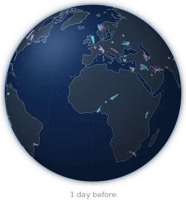
  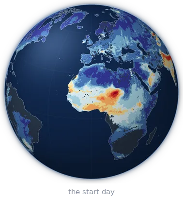
  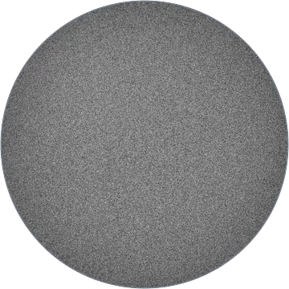
  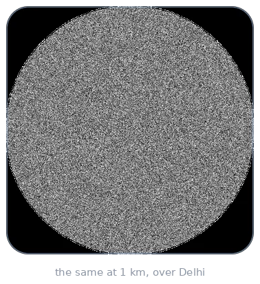
  <br><sub>Where the air came from (FLEXGREEN, 18 cities, five days back) · the start day turning into what the air carried
  (transport map) · a 1 km forecast forming from noise in the four steps of the sampler · the same at 1 km over Delhi.</sub>
</p>

# Foehn: global kilometre-scale forecasts of fine particulate matter

[](LICENSE)
[](https://ammarkheder.com/Foehn/)
[](https://arxiv.org/abs/2610.25941)

Foehn forecasts the daily fine particulate matter (PM<sub>2.5</sub>), from all its sources (traffic, industry, heating,
agriculture, desert dust, sea salt and fires), of every inhabited place on Earth at 1 km, from one day to
a week ahead, as an ensemble. Since version 1.1.0, a forecast of the same design at 0.4° and a generative downscaling also
deliver 1 km ensembles of eight members **in real time**, every day, for the day of issue and the four days after it. Foehn learns
from GHAP, a global dataset of daily PM<sub>2.5</sub> at 1 km over land (2017–2022), with the operational ECMWF weather forecast as input, generates whole continents in one pass by flow matching, and **computes rather
than learns the transport of the air**: FLEXGREEN, a GPU re-implementation of the backward mode of the FLEXPART particle model,
tells every receptor where its air was on the start day and which wildfire and anthropogenic emissions it took up on the way.

[Website](https://ammarkheder.com/Foehn/) · [Interactive viewer](https://ammarkheder.com/Foehn/#viewer) · [Preprint (arXiv:2610.25941)](https://arxiv.org/abs/2610.25941) · [How it works](#how-foehn-works) · [Getting started](#getting-started)

## Contents

- [What is Foehn?](#what-is-foehn)
- [How Foehn works](#how-foehn-works)
- [Results](#results)
- [Benchmark](#benchmark)
- [Version 1.2.0: noise design and the analyses of the submitted manuscript](#version-120-noise-design-and-the-analyses-of-the-submitted-manuscript)
- [Version 1.1.0: real time, downscaling and new analyses](#version-110-real-time-downscaling-and-new-analyses)
- [Getting started](#getting-started)
- [Repository layout](#repository-layout)
- [Trained weights](#trained-weights)
- [Citation](#citation)
- [License and acknowledgements](#license-and-acknowledgements)

## What is Foehn?

Air pollution is forecast on grids about 40 km wide, while PM<sub>2.5</sub> changes from one street to the next. Foehn
forecasts it at the kilometre, for the whole planet, as an ensemble:

- **Kilometre scale, in large windows.** A generative network trained by flow matching produces a window of 4,192 × 6,992
  pixels at 1 km in one pass; 21 overlapping windows, blended at their edges and sharing one noise field per member, cover
  the land between 84°N and 60°S.
- **Sharp, reliable ensembles.** Each member is one plausible 1 km forecast. A short fine-tuning on the CRPS brings the
  spread of the ensemble up to its error against the 1 km estimates (ratio 0.96–0.99 at every lead time from 1 to 7 days
  in 2022).
- **Computed transport (FLEXGREEN).** The physics decides where the air comes from; the network learns only what it carries.
  Every forecast comes with its Green's functions: where the air reaching each place was, at which height, and what it took
  up on the way.
- **In real time (version 1.1.0).** The 1 km model starts from estimates that are produced after the fact. A forecast of
  the same design at 0.4°, run each day from the operational analysis, and a generative downscaling that draws each of its
  members at 1 km deliver kilometre-scale ensembles every day.

<p align="center">
  <a href="docs/figures/fig_overview.png">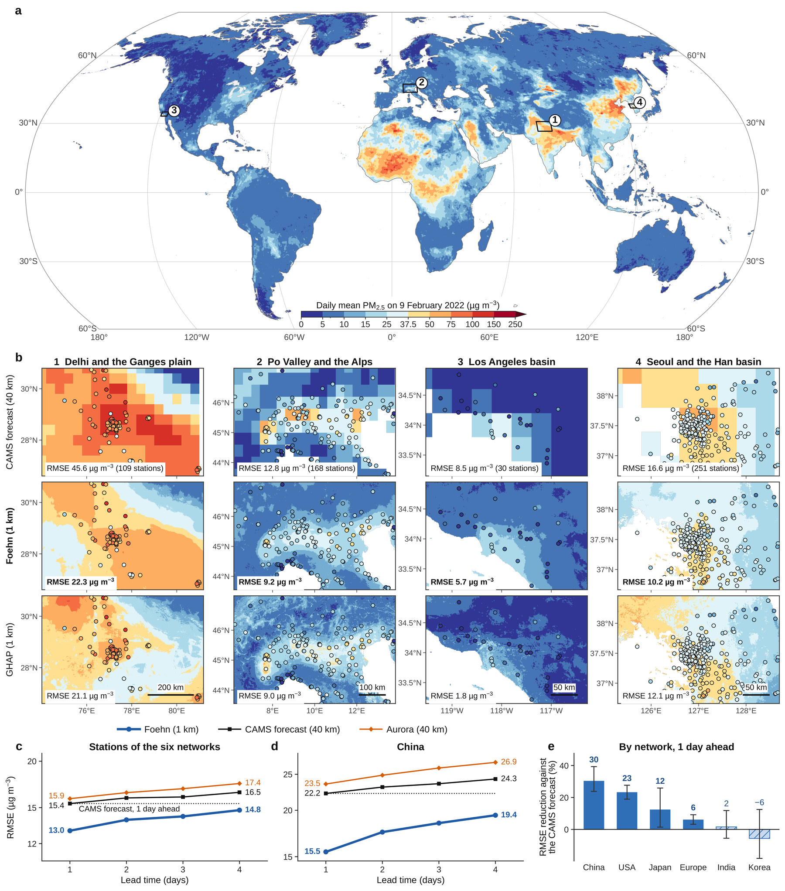</a>
</p>

## How Foehn works

FLEXGREEN, a GPU re-implementation of the backward mode of the FLEXPART particle model, releases particles in every 0.5°
land cell on the target day and follows them backwards in the three-dimensional forecast wind, with turbulence and removal.
The result is the Green's function of the transport: where the arriving air was on the start day, at which height, and how
much of its aerosol survived the journey. It has no learned parameter. The network reads the start-day fields where the
physics says the air was, and generates the 1 km field of the target day by flow matching; each noise field gives one
ensemble member.

<p align="center">
  <a href="docs/figures/fig_architecture.png"></a>
  <br><sub><b>a</b>, computed transport (FLEXGREEN) · <b>b</b>, learned tracers read where the air was · <b>c</b>, the flow-matching generator, from noise to a 1 km forecast in four steps · close-up of the generator as it runs. Click for the full-resolution figure.</sub>
</p>
<p align="center"><a href="https://www.youtube.com/watch?v=XB7i0QX7OCo"><b>▶ Watch the film: Foehn, the full story (8 min, narrated, on YouTube)</b></a> · <a href="https://ammarkheder.com/Foehn/#how">the interactive animated figure</a><br><sub>Watch it in your language: ⚙ Settings › Audio track (32 languages)</sub></p>

**Animated series.** *Foehn from A to Z* is a series of twelve animated episodes and a full film of about 44 minutes that explain how Foehn works, block by block, from the problem and the data to FLEXGREEN, the generator, the training and the results. The numbers are those of the preprint; the narration is generated by AI from the author's own voice, and the music is generated by AI. Watch it on YouTube: [international playlist](https://www.youtube.com/playlist?list=PLVRzz9roC0QQ) (English, with dubbed audio tracks in ten languages, translated subtitles and titles).

## Results

Test year 2022 (retrospective forecasts), scored at more than 6,000 stations of six official networks that were never used to
train or select the model, on UTC days like the forecasts, against the CAMS operational forecast and Aurora issued at the same
time. The numbers are those of the manuscript as submitted, with the noise design of release v1.2.0; the arXiv preprint is an
earlier version, and some of its numbers differ. With eight members, Foehn's RMSE 1 day ahead is 17 % (95 % interval,
12–24 %) below that of the CAMS forecast and 19 % (15–25 %) below that of Aurora; 3 days ahead it is 13 % (8–21 %) and
18 % (15–23 %) below.

| | Foehn | CAMS | Aurora |
|---|---|---|---|
| RMSE, 1 day (µg m⁻³) | **12.8** | 15.4 | 15.9 |
| RMSE, 3 days (µg m⁻³) | **13.9** | 16.0 | 16.9 |
| CRPS, 1 day (µg m⁻³) | **4.5** | 7.9 | 8.3 |
| SEDI, local P99, 1 day | **0.63** | 0.47 | 0.46 |
| Stations better than CAMS, 1 day | **69 %** | – | – |

RMSE of the ensemble mean at the stations (6,207 stations scored 1 day ahead; the same station-days for the three systems).
Foehn's RMSE is that of eight members, estimated from the four members run for every start day and a sixteen-member run; with
the four members as run it is 13.0 at 1 day and 14.2 at 3 days. CRPS: for Foehn, the fair CRPS estimated from its four
members, which is the value for infinitely many members (with eight members the CRPS is 24.5 % below that of the
climatological ensemble, against 29.7 % for the fair CRPS); for the CAMS forecast and Aurora, which give a single forecast,
the absolute error. SEDI: Foehn's four-member ensemble mean, over land, for the days above the local 99th percentile of the
1 km estimates. Last row: share of the 6,133 stations with at least 30 common forecast days at which the RMSE of Foehn's
four-member mean is lower than that of the CAMS forecast.

<p align="center">
  <a href="docs/figures/fig_transport.png">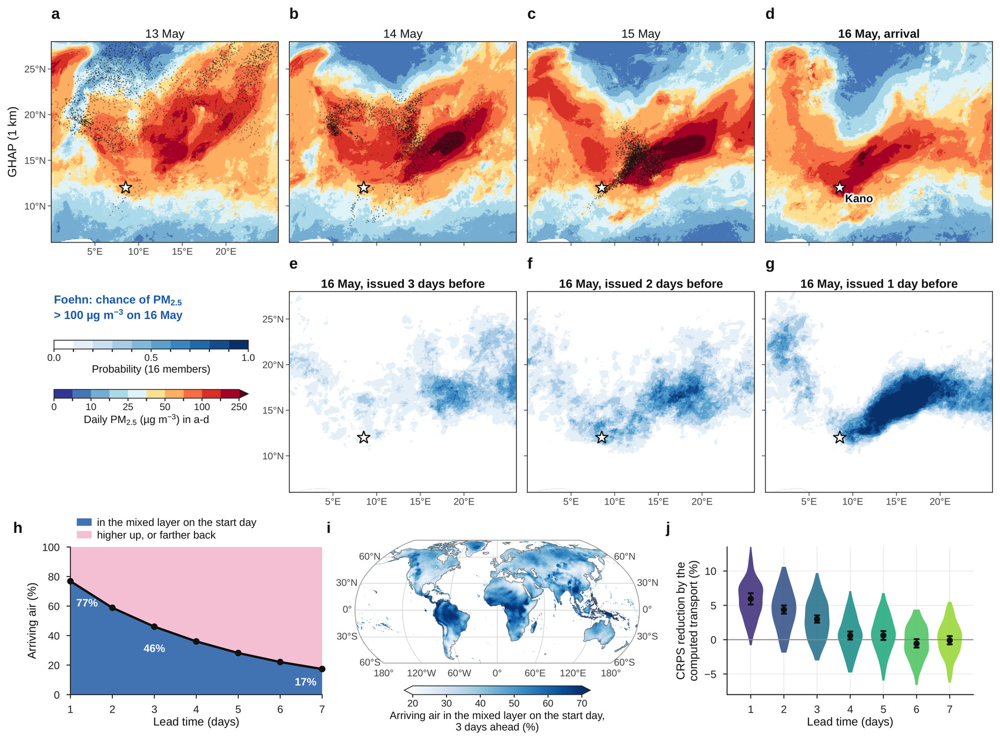</a>
</p>
<p align="center">
  <a href="docs/figures/fig_smoke.png">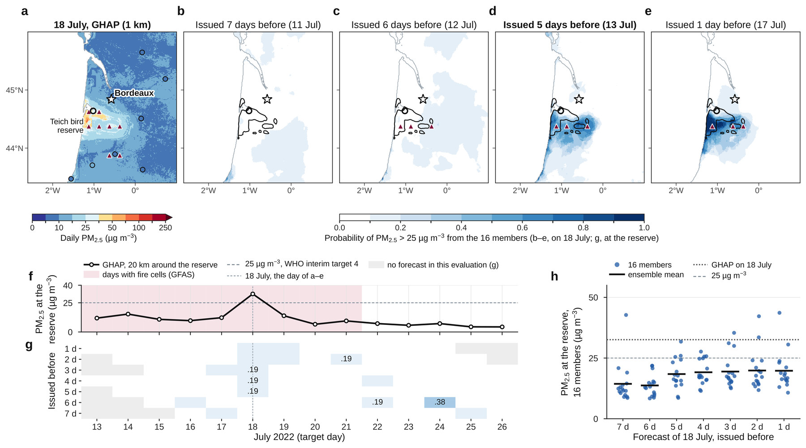</a>
</p>

### In real time

Over 48 issue days of autumn 2026 (the forecasts issued on 3–11 November and reforecasts of 39 earlier days made by the same
frozen system from the data of each day), at 11,121 OpenAQ monitors that no part of the system has seen, the error of the
real-time 1 km forecast is 14 % below that of the CAMS forecast of the same cycle (95 % interval, 7–21 %) and lower on each of
the five lead days; it is 10 % below that of the 0.4° forecast from which it is drawn and 5 % below that of the climatology of
the 1 km estimates. In Europe the two forecasts are equal. The scorer is in
[`downscaling/realtime_1km/replay/score/`](downscaling/realtime_1km/replay/score/).

<p align="center">
  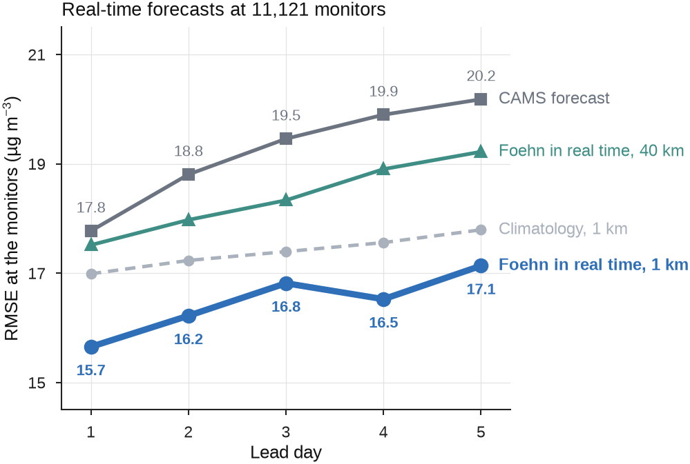
</p>

## Benchmark

The design was guided by a controlled benchmark over Europe: a 0.25° precursor of Foehn's flow-matching network, with a
learned transport layer, against five spatiotemporal networks retrained by regression with the same target, start-day
estimates and forecast weather (their other inputs differ), the CAMS operational forecast, Aurora and climatology. Europe,
2022; scores averaged over lead times of 1 to 4 days and three trainings (one run for Aurora, CAMS and climatology). RMSE in
µg m⁻³ (lower is better), CSI of exceedances of 25 µg m⁻³ (higher is better), and the inference time and peak memory for one
member and one lead time on one AMD MI250X compute die (for Aurora, one lead day of its global forecast of all its variables).

<p align="center">
  <a href="docs/figures/fig_benchmark_leadtime.png">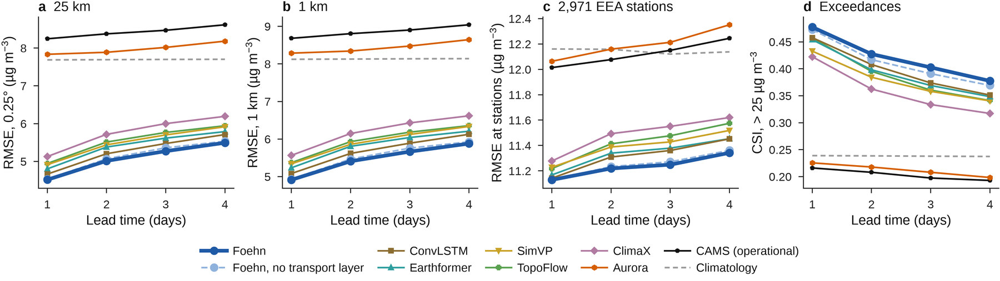</a>
</p>
<p align="center">
  <a href="docs/figures/fig_benchmark_scorecard.png">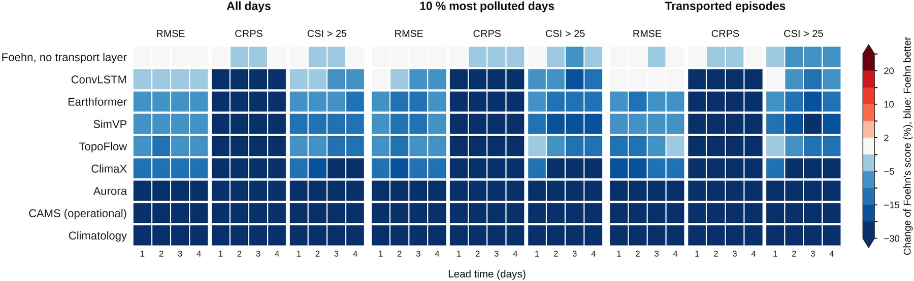</a>
</p>
<p align="center">
  <a href="docs/figures/fig_benchmark_scales_cost.png">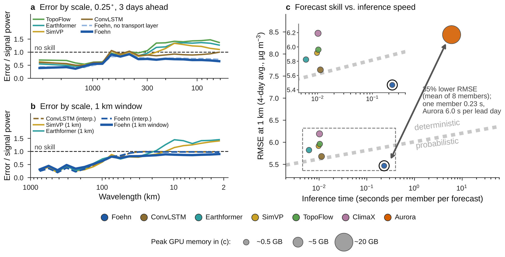</a>
</p>

Over the 324 comparisons of the scorecard (nine systems, three scores, four lead times and three sets of days: all days, the
10 % most polluted days and documented transport episodes), the network scores better in 319; blue means Foehn better. The
five others are RMSE cells within 1.3 %: four against the same network without its transport layer and one against ConvLSTM.
Against the 1 km estimates, the mean of its eight members has a 35 % lower error than Aurora (5.47 against 8.44 µg m⁻³). One
member takes 0.23 s per lead time, against 6.0 s for one lead day of Aurora; the two times do not measure the same task,
since Aurora forecasts all its variables over the globe. The table is produced by `figures/benchmark_table.py`; the scripts
of the benchmark are in `benchmark_europe/`.

<details>
<summary>The scores as a table</summary>

| Model | RMSE, 0.25° | RMSE, 1 km | RMSE, EEA stations | CSI, > 25 µg m⁻³ | Inference (s) | GPU memory (GB) |
|---|---:|---:|---:|---:|---:|---:|
| Foehn (flow matching, European 0.25° version) | **5.07** | **5.47** | **11.23** | **0.421** | 0.231 | 0.15 |
| Foehn without the learned transport layer | 5.12 | 5.52 | 11.25 | 0.413 | 0.045 | 0.15 |
| ConvLSTM | 5.26 | 5.68 | 11.32 | 0.398 | 0.011 | 0.72 |
| Earthformer | 5.40 | 5.82 | 11.34 | 0.392 | 0.006 | 0.42 |
| SimVP | 5.49 | 5.92 | 11.39 | 0.379 | 0.010 | 0.10 |
| TopoFlow | 5.54 | 5.96 | 11.42 | 0.388 | 0.010 | 0.43 |
| ClimaX | 5.76 | 6.19 | 11.49 | 0.359 | 0.010 | 0.95 |
| Aurora | 7.98 | 8.44 | 12.20 | 0.212 | 6.0 | 20.40 |
| CAMS operational forecast | 8.43 | 8.86 | 12.12 | 0.204 | – | – |
| Climatology | 7.70 | 8.13 | 12.14 | 0.238 | – | – |

EEA stations: 2,063 of the 2,971 sampling points of the station file reported in 2022.

</details>

## Version 1.2.0: noise design and the analyses of the submitted manuscript

Release v1.2.0 adds the code with which the results of the submitted manuscript were computed.

- **Noise design** ([`analyses/noise_design/`](analyses/noise_design/)): the noise field of each member is drawn anew at every
  start day and evolves between lead days as a first-order autoregressive process (rho = 0.59, chosen and confirmed on 2021),
  with the runs of 2022 under this design and the chain that recomputes the analyses of the 1 km model with `FOEHN_DESIGN=ar`.
- **Ensemble size** ([`analyses/ensemble_size/`](analyses/ensemble_size/)): scores for eight and for infinitely many members,
  and warnings of eight members drawn from sixteen.
- **Opposite pairs and the noise-aware mean** ([`analyses/opposite_pairs/`](analyses/opposite_pairs/),
  [`analyses/noise_aware_mean/`](analyses/noise_aware_mean/)): the two tests on 2022 under rules fixed before the runs, and their
  validations on 2021.
- **A layer fed by the monitors** ([`downscaling/monitor_layer/`](downscaling/monitor_layer/)): the reforecast of the 48 issue
  days with the measurements of the day before as an input.
- **Warnings** ([`analyses/hidden/v3/`](analyses/hidden/v3/)): the warnings of Foehn and of five references as in the submitted
  manuscript (a further reference, exact warning factors and centred blocks).
- **Figures** ([`figures/version_1_2/`](figures/version_1_2/)): the figures and the Source Data of the manuscript as submitted.
- **Transport in real time** (`foehn/flexgreen.py`): the options `--rt-dir` and `--emis-fallback`, with which
  `foehn/realtime/flexgreen_batch.sh` computes the Green's functions of each real-time day.
- **Station matching**: the station scores (`figures/compare_fair.py`, the `extremes_stations*` scripts of `figures/` and
  `analyses/issuance/`, `analyses/circularity/scripts/extract_station_day.py`) match the station files by exact coordinates
  and by order, so that co-located stations stay separate: 183 official stations that the earlier key left without a forecast
  are now scored.

The scripts of `analyses/`, `figures/` and `downscaling/test2022_official/` that these analyses run were updated for the switch
`FOEHN_DESIGN`. In the files added in this version and in those updated for these analyses, the absolute paths of the cluster
are given by two environment variables: `FOEHN_WORK`, the folder that holds the working trees, and `FOEHN_ENVS`, the folder of
the Python environments; the scripts expect the layout of the working trees under `$FOEHN_WORK`, which the README of each new
folder describes. Set both variables for every script: the scripts of earlier versions keep their absolute paths, and some of
them import the updated modules. Four of the five scorers fixed before their runs are released byte for byte, with their
SHA-256 in the README of their folder; `score_final.py` differs only by the folder name `realtime_1km`. The Slurm
scripts of this version are submitted from their working folder and take the account on the command line
(`sbatch --account=...`). Where a script or a README cites a paragraph of the Methods, the paragraph of the same title in
the Supplementary Methods of the manuscript gives it in full, with the numbers quoted.

## Version 1.1.0: real time, downscaling and new analyses

Release v1.1.0 adds the code of the revised manuscript, which issues kilometre-scale forecasts in real time.

- **Real-time forecast at 0.4°** ([`foehn/realtime/`](foehn/realtime/)): the network of the comparison in Aurora's protocol,
  fine-tuned on the inputs available every morning and run each day from the CAMS analysis, the open-data weather forecast of
  ECMWF and the fire emissions of the previous day, with eight members.
- **Generative downscaling to 1 km** ([`downscaling/`](downscaling/)): a model that draws a 1 km member over all land from each
  coarse member. It builds on functional flow matching ([CD-FFM](https://github.com/Holmes-Alan/CD-FFM)), with the computed
  transport among its inputs and a noise prior refitted to the 1 km estimates. The folder also holds the real-time 1 km
  forecast, the reforecasts, the scorer of the verification at the monitors and the tests on 2022.
- **Analyses** ([`analyses/`](analyses/)): comparisons at equal issuance time, hidden exposure and warnings, reliability of the
  ensembles, the tests of the dependence between the stations and the 1 km estimates, and the effect of the emission inputs
  against a control.
- **Figures** ([`figures/version_1_1/`](figures/version_1_1/)): the figures added or redrawn in this version and the builder of the
  Source Data.

Stations and monitors are used for evaluation only. Each folder has a README that lists its scripts.

## Getting started

The code was developed and run on the LUMI supercomputer (AMD MI250X, ROCm) with PyTorch and PyTorch Lightning. The Python
code depends on the LUMI environment only through its absolute data paths (set at the top of each script; in the files of
version 1.2.0, the environment variables `FOEHN_WORK` and `FOEHN_ENVS`); the Slurm scripts also name LUMI partitions and its
PyTorch container image.

```bash
git clone https://github.com/AmmarKheder/Foehn
cd Foehn
pip install -r requirements.txt
```

The pipeline, in order (each script documents its arguments in its docstring; the SLURM scripts in `foehn/jobs/` show the
exact calls used):

| Step | Script |
|---|---|
| Download the HRES forecasts (WeatherBench 2), CAMS forecasts and analyses, GFAS | `foehn/dl_wb2.py`, `foehn/dl_hres_global.py`, `foehn/dl_cams_forecast12h.py`, `foehn/dl_cams_analysis.py` |
| Build the 1 km tiles (GHAP, static fields), the 0.25° inputs, the stations and the population | `foehn/build_fine_tiles.py`, `foehn/build_static.py`, `foehn/build_coarse.py`, `foehn/build_stations.py`, `foehn/build_population.py` |
| Compute the FLEXGREEN Green's functions for every start day and lead | `foehn/flexgreen.py` (`foehn/jobs/flexgreen_job.sh`) |
| Train the global model, fine-tune it with the anthropogenic emissions, then train the ensemble on the CRPS | `foehn/fullflow_global_green.py` (see [Reproducing the final model](#reproducing-the-final-model)) |
| Forecast and evaluate (global maps, stations, cases) | `foehn/eval_global_green.py` (`foehn/jobs/eval_green_job.sh`), `foehn/summarize_eval.py` |
| Foehn in Aurora's protocol (0.4° CAMS analyses) | `foehn/foehn_cams.py`, `foehn/eval_cams12h.py` |
| Figures and tables of the preprint | `figures/*.py` (`figures/final_model.py` names the final run) |

The controlled European benchmark that selected the design (five retrained networks, flow matching against regression, the
learned transport layer, tiling seams) is in `benchmark_europe/`. `foehn/calibrate.py` is an EMOS post-processing experiment
that the final model does not use (no post-processing is applied; the ensemble is calibrated by training).

### Reproducing the final model

The final model, the same in the preprint and in the manuscript as submitted, is the run
`green_flow_shift25_global_L7_noant_whres_ghres_ftemis12_crps4`, checkpoint
`epoch=01.ckpt`, obtained in three stages with `foehn/fullflow_global_green.py train` (launched through
`foehn/jobs/train_green_job.sh` on 4 nodes of LUMI-G; the Green's functions must have been computed first with
`foehn/flexgreen.py`):

```bash
# 1. base model: flow matching with the HRES forecast weather and the HRES Green's functions, 60 epochs
python fullflow_global_green.py train --weather hres --green hres --epochs 60 --workers 6
# 2. fine-tuning with the six anthropogenic emission channels (12 epochs; the checkpoint after the third epoch, epoch=02.ckpt, selected on 2021)
python fullflow_global_green.py train --weather hres --green hres --store green --psub 16 --emis --emis-store green256 \
    --emis-scale 10 --init runs/green_flow_shift25_global_L7_noant_whres_ghres/final.ckpt --epochs 12 --lr 5e-5 \
    --workers 6 --keep-all-ckpt --tag _ftemis12
# 3. CRPS training of the ensemble through the four-step sampler (2 epochs; the checkpoint after the second epoch, epoch=01.ckpt, selected on 2021, is the final model)
python fullflow_global_green.py train --weather hres --green hres --store green --psub 32 --emis --emis-store green256 \
    --emis-scale 10 --init runs/green_flow_shift25_global_L7_noant_whres_ghres_ftemis12/ckpts/epoch=02.ckpt --epochs 2 \
    --lr 2e-5 --workers 6 --crps-steps 4 --crps-fm 1.0 --keep-all-ckpt --tag _ftemis12_crps4
# evaluation of 2022 with the first noise design (one noise field per member, reused at every start day and lead time):
# every second start day, leads 1-7, 4 members, 4 Euler steps
python eval_global_green.py runs/green_flow_shift25_global_L7_noant_whres_ghres_ftemis12_crps4 \
    --ckpt runs/green_flow_shift25_global_L7_noant_whres_ghres_ftemis12_crps4/ckpts/epoch=01.ckpt \
    --psub 16 --steps 4 --refine-tail 1 --members 4 --every 2 --out eval_final_crps_e01
```

`figures/final_model.py` records these names so that every figure script reads the same evaluation.

In the manuscript as submitted, the noise field of each member is drawn anew at every start day and evolves between lead days
as a first-order autoregressive process (rho = 0.59, set on 2021). The same weights are evaluated under this design by the
scripts of [`analyses/noise_design/`](analyses/noise_design/) (order and working folders in its README; the evaluation of
2022 is `test_2022/jobs/g1.sh`, output `eval_final_crps_e01_ar`). With `FOEHN_DESIGN=ar`, `figures/final_model.py` adds the
suffix `_ar` to the evaluation folders of the final model, so that the figure scripts read the forecasts of this design; with
`FOEHN_DESIGN` unset, they read those of the first design.

## Environment

The scripts were run on the LUMI supercomputer (AMD MI250X, ROCm 6.1.3) inside the container
`lumi-pytorch-rocm-6.1.3-python-3.12-pytorch-v2.4.1.sif` (PyTorch 2.4.1, Python 3.12, PyTorch Lightning), with the
packages of `requirements.txt`. The data paths are absolute paths on LUMI, set at the top of each script (the files of
version 1.2.0 build them from `FOEHN_WORK` and `FOEHN_ENVS`); on another machine, point them to your copies of the data listed
in the Data availability statement of the paper. A syntax check of every script runs on each push (`python -m compileall`).

## Script map

| Purpose | Scripts in `foehn/` |
|---|---|
| Download the inputs | `dl_wb2.py`, `dl_hres_global.py`, `dl_hres_global_ext.py`, `dl_cams_forecast12h.py`, `dl_cams_analysis.py` |
| Build the 1 km tiles, the 0.25° inputs, the static fields, the stations, the population | `build_fine.py`, `build_fine_tiles.py`, `build_coarse.py`, `build_static.py`, `build_stations.py`, `build_india.py`, `build_japan.py`, `build_korea.py`, `korea_openaq_coords.py`, `build_population.py`, `build_hres_train.py`, `build_hres_year.py`, `build_cams_series.py` |
| Computed transport | `flexgreen.py` (the Green's functions), `build_transport.py`, `tests/` |
| Train the global model | `fullflow_global_green.py` (base model, emission fine-tuning and CRPS training; earlier stages `fullflow_global.py`, `fullflow_global_fp.py` are kept because it imports their data classes) |
| Forecast and evaluate | `eval_global_green.py`, `summarize_eval.py`, `compare_models.py`, `compare_baselines.py`, `reliability_stations.py`, `traj_error.py`, `case_beijing_summary.py` |
| Model selection on 2021 | `select_2021.py`, `select_crps_and_launch.py`, `prep_test.py` |
| Foehn in Aurora's protocol | `foehn_cams.py`, `eval_cams12h.py`, `eval_cams12h_stations.py` |
| Checks and profiling | `audit_inputs.py`, `check_stations.py`, `station_ghap_history.py`, `bench_loader.py`, `profile_loader.py`, `conv_summary.py` |
| Not used by the final model | `calibrate.py` (EMOS post-processing experiment), `eval_global_fp*.py` (earlier stage) |

The figure scripts in `figures/` are named after the figure they draw (`fig_*.py`, `figED_*.py`); `figdata_*.py`,
`compare_fair.py`, `tail_events.py` and `extremes_stations.py` build their intermediate data from the evaluation outputs.

## Repository layout

```
foehn/             FLEXGREEN transport, data preparation, training, calibration, inference and evaluation of the global model
foehn/tests/       unit checks of FLEXGREEN (well-mixed limit, boundary layer, 12-h Green's functions)
foehn/jobs/        SLURM scripts used on LUMI
foehn/realtime/    the real-time forecast at 0.4 degrees (version 1.1.0)
downscaling/       generative downscaling to 1 km, real-time 1 km forecast, reforecasts and their verification (version 1.1.0),
                   the layer fed by the monitors (version 1.2.0)
analyses/          the analyses added in versions 1.1.0 and 1.2.0 (noise design, ensemble size, opposite pairs, noise-aware mean)
benchmark_europe/  stage 1: the controlled benchmark over Europe (dejavu, retrain, regional, fullimage, cascade, benchmark)
figures/           every figure and table of the preprint, and the scripts that build their intermediate data
figures/version_1_1/  the figures added or redrawn in version 1.1.0 and the builder of the Source Data
figures/version_1_2/  the figures and the Source Data of the manuscript as submitted (version 1.2.0)
docs/              the website and the interactive viewer (GitHub Pages)
docs/figures/      figures of the preprint used in this README and on the website
```

## Trained weights

The trained weights of five models of the retrospective evaluation are archived at Zenodo
(<https://doi.org/10.5281/zenodo.23337591>), with their SHA-256 checksums and the inference commands: the final 1 km model
(14.2 million parameters), the model with emissions before the calibration, the base model, the model without transport, and
Foehn-CAMS, the model of the comparison in Aurora's protocol (9.9 million parameters). During peer review, access to the files
is restricted to the editors and referees; it will be opened upon publication. The weights of the real-time system and of the
downscaling model are available to the editors and referees on request and will be released upon publication. The forecast
and transport fields are too large to deposit; they can be regenerated from the public inputs with this code and the weights.

## Citation

Kheder A., Boy M. & Liu Z.-S. (2026). *Global probabilistic forecasting of air pollution.* arXiv:2610.25941.
<https://arxiv.org/abs/2610.25941>

```bibtex
@misc{kheder2026foehn,
  title         = {Global probabilistic forecasting of air pollution},
  author        = {Kheder, Ammar and Boy, Michael and Liu, Zhi-Song},
  year          = {2026},
  eprint        = {2610.25941},
  archivePrefix = {arXiv},
  primaryClass  = {cs.AI},
  url           = {https://arxiv.org/abs/2610.25941}
}
```

A revised version of this paper, *Global probabilistic forecasting of fine particulate air pollution at the kilometre scale*
(Kheder, Boy and Liu), has been submitted for publication; release v1.2.0 holds the code of its analyses. Release v1.0.0 of
this code is archived at Zenodo (<https://doi.org/10.5281/zenodo.23337751>).

## License and acknowledgements

Released under the [MIT License](LICENSE).

This work was supported by the Finnish Ministry of Education and Culture's Pilot for Doctoral Programmes (Mathematics of
Sensing, Imaging and Modelling), the ACCC Flagship of the Academy of Finland (grant 337549) and the city of Lahti. We thank
CSC – IT Center for Science, Finland, for access to the LUMI supercomputer, owned by the EuroHPC Joint Undertaking and hosted
by CSC (Finland) and the LUMI consortium, and the providers of the data: GHAP (Wei et al.), ECMWF (ERA5 and the HRES and IFS
forecasts) and the Copernicus Atmosphere Monitoring Service (CAMS, GFAS, CAMS-GLOB-ANT), WeatherBench 2, GHS-POP (JRC),
ETOPO 2022 (NOAA), OpenAQ, and the monitoring networks of the EEA, CNEMC, US EPA, AirKorea, NIES Japan and CPCB India.
