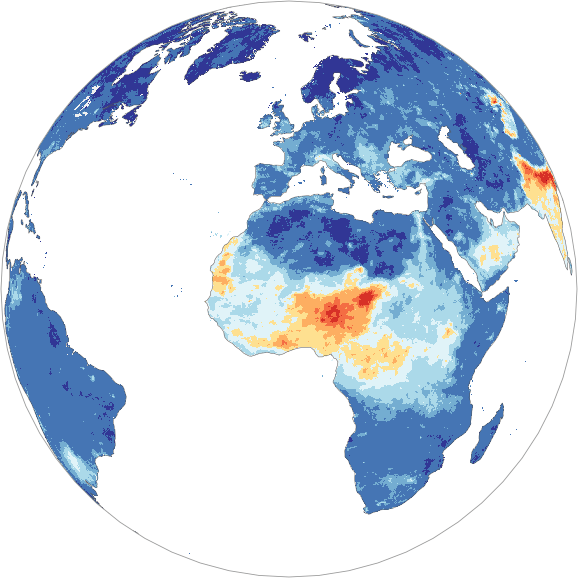
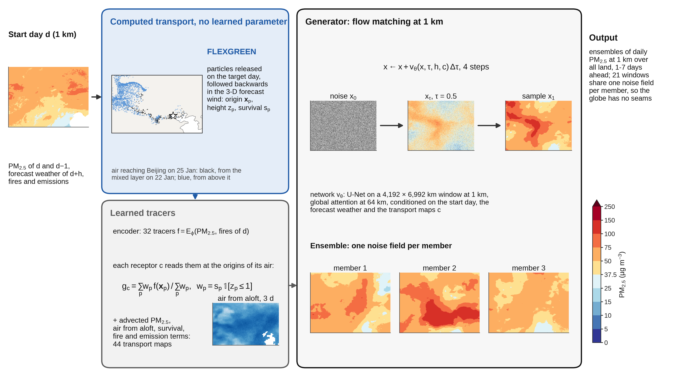

<p align="center">
  
</p>
<p align="center">
  
</p>

# Foehn: global kilometre-scale probabilistic forecasts of fine particulate matter

[](LICENSE)
[](https://ammarkheder.github.io/Foehn/)
[](#citation)

Foehn forecasts the daily fine particulate matter (PM<sub>2.5</sub>) of every inhabited place on Earth at 1 km, from one day to
a week ahead, as a calibrated ensemble. It learns from the first global record of daily PM<sub>2.5</sub> at 1 km (GHAP) with
the operational ECMWF weather forecast as input, generates whole continents in one pass by flow matching, and **computes rather
than learns the transport of the air**: FLEXGREEN, a GPU re-implementation of the backward mode of the FLEXPART particle model,
tells every receptor where its air was on the start day and which wildfire and anthropogenic emissions it took up on the way.

[Interactive viewer](https://ammarkheder.github.io/Foehn/#viewer) · [Paper](#citation) · [How it works](#how-foehn-works) · [Getting started](#getting-started)

## Contents

- [What is Foehn?](#what-is-foehn)
- [How Foehn works](#how-foehn-works)
- [Results](#results)
- [Getting started](#getting-started)
- [Repository layout](#repository-layout)
- [Trained weights](#trained-weights)
- [Citation](#citation)
- [License and acknowledgements](#license-and-acknowledgements)

## What is Foehn?

Air pollution is forecast on grids about 40 km wide, while PM<sub>2.5</sub> changes from one street to the next. Two
bottlenecks kept machine learning from forecasting it where it harms: resolution (kilometre-scale targets over the globe
are recent, and tiling such large images leaves seams) and the peaks (squared-error training smooths them away). Foehn removes
both:

- **Kilometre scale, one pass.** A flow-matching network generates windows of 29 million pixels (a continent at 1 km) in one
  pass, with global attention at 64 km; twenty-one windows cover the land and blend with no visible seam.
- **Sharp, calibrated ensembles.** Each sample is one plausible 1 km forecast; the ensemble is trained on the CRPS so that
  its spread matches its error, to seven days ahead.
- **Computed transport (FLEXGREEN).** The physics decides where the air comes from; the network learns only what it carries.
  Every forecast comes with its Green's functions: where the air reaching each place was, at which height, and what it took up.

<p align="center">
  
</p>

## How Foehn works

<p align="center">
  
</p>

1. **FLEXGREEN** releases particles in every 0.5° land cell on the target day and follows them backwards in the 3-D forecast
   wind (Petterssen advection, boundary-layer turbulence, dry and wet removal), returning for each particle its origin on the
   start day, its height relative to the mixed layer and its survival. No learned parameter.
2. **Learned tracers.** A small encoder turns the start-day maps (PM<sub>2.5</sub>, fire emissions) into 32 latent tracers that
   every receptor reads at the origins of its particles; with the advected PM<sub>2.5</sub>, the share of air from aloft, the
   survival and the emissions met on the way, they form 44 transport maps.
3. **Generator.** Conditioned on the 1 km fields of the start day, the forecast weather and the transport maps, a U-Net with
   global attention carries a noise field to a 1 km forecast along the flow-matching path in four steps. Each noise field is one
   ensemble member.

## Results

Test year 2022, forecasts scored against 6,612 official monitoring stations never used in training, with the CAMS operational
forecast and Aurora issued at the same time (details and intervals in the paper):

| | Foehn | CAMS | Aurora |
|---|---|---|---|
| RMSE at the stations, 1 day ahead (µg m⁻³) | **12.4** | 15.6 | 16.0 |
| RMSE, 4 days ahead | **14.5** | 16.6 | 17.5 |
| CRPS, 1 day ahead (fair CRPS of 4 members; absolute error for single forecasts) | **4.2** | 8.1 | 8.5 |
| SEDI, days above the local 99th percentile, 1 day ahead | **0.63** | 0.45 | 0.43 |
| Stations where the error is lower than CAMS (5,959 stations with ≥ 30 common days) | **78 %** | – | – |

<p align="center">
  
</p>
<p align="center">
  
</p>

## Getting started

The code was developed and run on the LUMI supercomputer (AMD MI250X, ROCm) with PyTorch and PyTorch Lightning; it has no
dependency on the LUMI environment other than the absolute data paths set at the top of each script.

```bash
git clone https://github.com/AmmarKheder/Foehn
cd Foehn
pip install -r requirements.txt
```

The pipeline, in order (each script documents its arguments in its docstring; the SLURM scripts in `foehn/jobs/` show the
exact calls used):

| Step | Script |
|---|---|
| Download the HRES forecasts (WeatherBench 2), CAMS forecasts and analyses, GFAS | `foehn/dl_wb2.py`, `foehn/dl_hres_global.py`, `foehn/dl_cams_forecast12h.py`, `foehn/dl_cams_analysis.py` |
| Build the 1 km tiles (GHAP, static fields), the 0.25° inputs, the stations and the population | `foehn/build_fine_tiles.py`, `foehn/build_static.py`, `foehn/build_coarse.py`, `foehn/build_stations.py`, `foehn/build_population.py` |
| Compute the FLEXGREEN Green's functions for every start day and lead | `foehn/flexgreen.py` (`foehn/jobs/flexgreen_job.sh`) |
| Train the global model, fine-tune it with the anthropogenic emissions, then train the ensemble on the CRPS | `foehn/fullflow_global_green.py` (see [Reproducing the final model](#reproducing-the-final-model)) |
| Forecast and evaluate (global maps, stations, cases) | `foehn/eval_global_green.py` (`foehn/jobs/eval_green_job.sh`), `foehn/summarize_eval.py` |
| Foehn in Aurora's protocol (0.4° CAMS analyses) | `foehn/foehn_cams.py`, `foehn/eval_cams12h.py` |
| Figures and tables of the paper | `figures/*.py` (`figures/final_model.py` names the final run) |

The controlled European benchmark that selected the design (five retrained networks, flow matching against regression, the
learned transport layer, tiling seams) is in `benchmark_europe/`. `foehn/calibrate.py` is an EMOS post-processing experiment
that the final model does not use (no post-processing is applied; the ensemble is calibrated by training).

### Reproducing the final model

The final model of the paper is the run `green_flow_shift25_global_L7_noant_whres_ghres_ftemis12_crps4`, checkpoint
`epoch=01.ckpt`, obtained in three stages with `foehn/fullflow_global_green.py train` (launched through
`foehn/jobs/train_green_job.sh` on 4 nodes of LUMI-G; the Green's functions must have been computed first with
`foehn/flexgreen.py`):

```bash
# 1. base model: flow matching with the HRES forecast weather and the HRES Green's functions, 60 epochs
python fullflow_global_green.py train --weather hres --green hres --epochs 60 --workers 6
# 2. fine-tuning with the six anthropogenic emission channels (12 epochs; epoch 2 selected on 2021)
python fullflow_global_green.py train --weather hres --green hres --store green --psub 16 --emis --emis-store green256 \
    --emis-scale 10 --init runs/green_flow_shift25_global_L7_noant_whres_ghres/final.ckpt --epochs 12 --lr 5e-5 \
    --workers 6 --keep-all-ckpt --tag _ftemis12
# 3. CRPS training of the ensemble through the four-step sampler (2 epochs; epoch 1 selected on 2021 = final model)
python fullflow_global_green.py train --weather hres --green hres --store green --psub 32 --emis --emis-store green256 \
    --emis-scale 10 --init runs/green_flow_shift25_global_L7_noant_whres_ghres_ftemis12/ckpts/epoch=02.ckpt --epochs 2 \
    --lr 2e-5 --workers 6 --crps-steps 4 --crps-fm 1.0 --keep-all-ckpt --tag _ftemis12_crps4
# evaluation of 2022 (every second start day, leads 1-7, 4 members, 4 Euler steps)
python eval_global_green.py runs/green_flow_shift25_global_L7_noant_whres_ghres_ftemis12_crps4 \
    --ckpt runs/green_flow_shift25_global_L7_noant_whres_ghres_ftemis12_crps4/ckpts/epoch=01.ckpt \
    --psub 16 --steps 4 --refine-tail 1 --members 4 --every 2 --out eval_final_crps_e01
```

`figures/final_model.py` records these names so that every figure script reads the same evaluation.

## Repository layout

```
foehn/             FLEXGREEN transport, data preparation, training, calibration, inference and evaluation of the global model
foehn/tests/       unit checks of FLEXGREEN (well-mixed limit, boundary layer, 12-h Green's functions)
foehn/jobs/        SLURM scripts used on LUMI
benchmark_europe/  stage 1: the controlled benchmark over Europe (dejavu, retrain, regional, fullimage, cascade, benchmark)
figures/           every figure and table of the paper, and the scripts that build their intermediate data
docs/              the website and the interactive viewer (GitHub Pages)
docs/figures/      figures of the paper used in this README and on the website
```

## Trained weights

The weights of the final model (14.2 million parameters) and the forecasts of the 2022 evaluation are available to the editors
and referees, and will be released here with a Zenodo DOI upon publication.

## Citation

```bibtex
@article{kheder2026foehn,
  title   = {Global kilometre-scale probabilistic forecasts of fine particulate matter},
  author  = {Kheder, Ammar and Boy, Michael and Liu, Zhi-Song},
  year    = {2026},
  note    = {Manuscript submitted}
}
```

## License and acknowledgements

Released under the [MIT License](LICENSE).

This work was supported by the Finnish Ministry of Education and Culture's Pilot for Doctoral Programmes (Mathematics of
Sensing, Imaging and Modelling), the ACCC Flagship of the Academy of Finland (grant 337549) and the city of Lahti. We thank
CSC – IT Center for Science, Finland, for access to the LUMI supercomputer, and the providers of the data: GHAP (Wei et al.),
ECMWF and the Copernicus Atmosphere Monitoring Service (CAMS, GFAS, CAMS-GLOB-ANT), WeatherBench 2, GHS-POP, and the
monitoring networks of the EEA, CNEMC, US EPA, AirKorea, NIES Japan and CPCB India.
