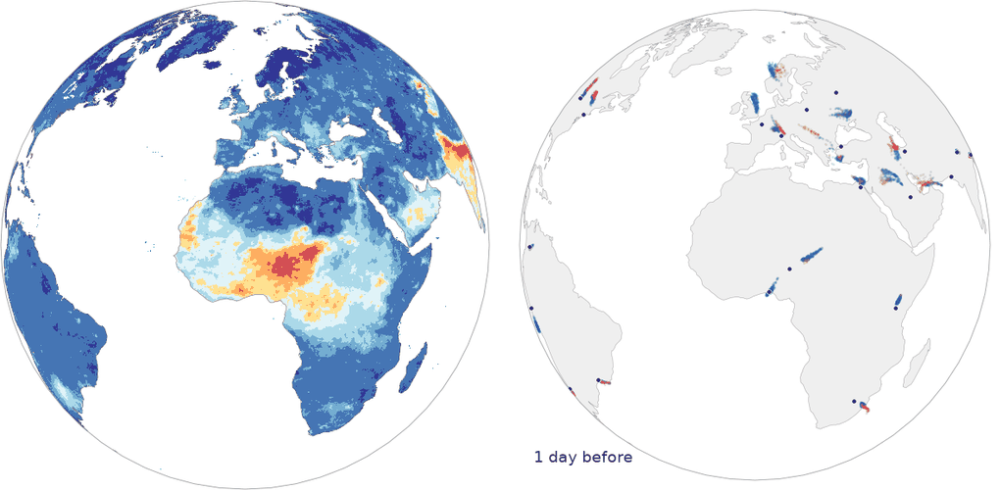
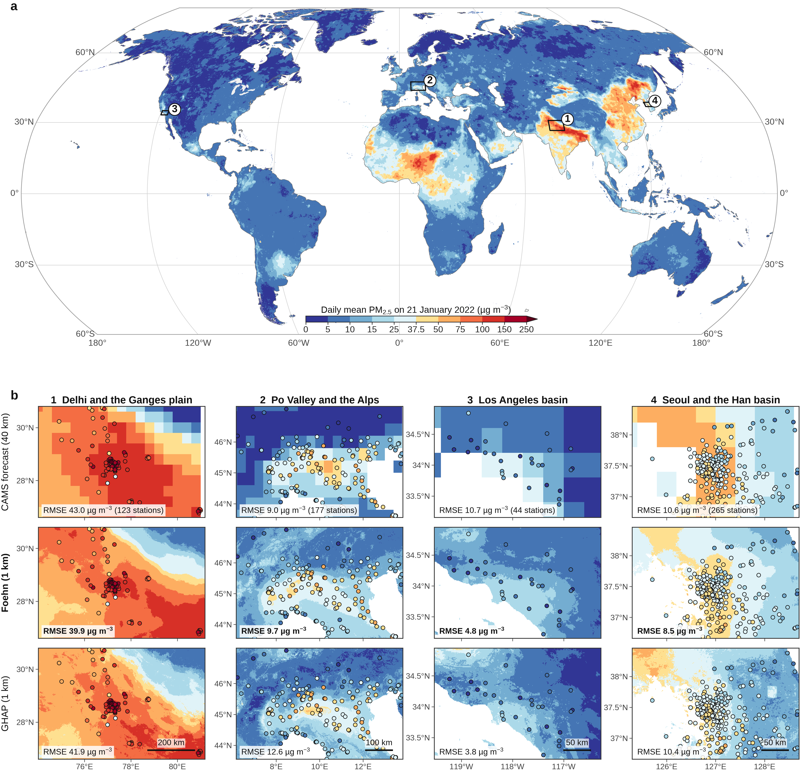
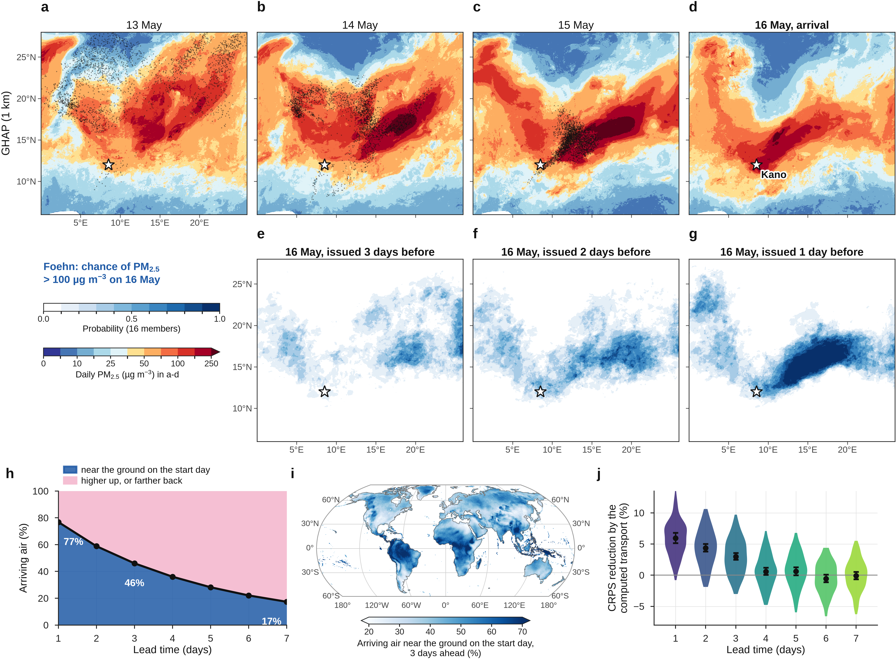
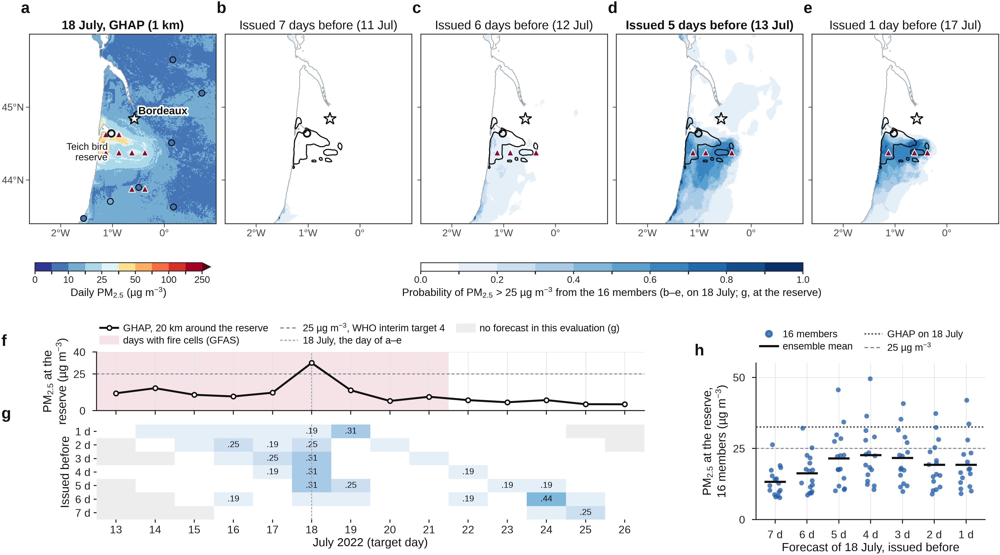

<p align="center">
  
</p>
<p align="center">
  
  <br><sub>Left: Foehn's forecast of daily PM<sub>2.5</sub> at 1 km for 21 January 2022, issued the evening before (ensemble mean). Right: FLEXGREEN, where the air arriving in thirty cities on that day was, one to seven days before (256 particles per city; blue, in the mixed layer on the start day; pink, aloft).</sub>
</p>

# Foehn: global high-resolution forecasts of fine particulate matter

[](LICENSE)
[](https://ammarkheder.com/Foehn/)
[](#citation)

Foehn forecasts the daily fine particulate matter (PM<sub>2.5</sub>) of every inhabited place on Earth at 1 km, from one day to
a week ahead, as a calibrated ensemble. It learns from the first global record of daily PM<sub>2.5</sub> at 1 km (GHAP) with
the operational ECMWF weather forecast as input, generates whole continents in one pass by flow matching, and **computes rather
than learns the transport of the air**: FLEXGREEN, a GPU re-implementation of the backward mode of the FLEXPART particle model,
tells every receptor where its air was on the start day and which wildfire and anthropogenic emissions it took up on the way.

[Interactive viewer](https://ammarkheder.com/Foehn/#viewer) · [Paper](#citation) · [How it works](#how-foehn-works) · [Getting started](#getting-started)

## Contents

- [What is Foehn?](#what-is-foehn)
- [How Foehn works](#how-foehn-works)
- [Results](#results)
- [Getting started](#getting-started)
- [Repository layout](#repository-layout)
- [Trained weights](#trained-weights)
- [Citation](#citation)
- [License and acknowledgements](#license-and-acknowledgements)

## What is Foehn?

Air pollution is forecast on grids about 40 km wide, while PM<sub>2.5</sub> changes from one street to the next. Foehn
forecasts it at the kilometre, for the whole planet, as a calibrated ensemble:

- **Kilometre scale, one pass.** A generative network trained by flow matching produces whole continents at 1 km in one
  pass, with no visible seam between the windows that cover the land.
- **Sharp, calibrated ensembles.** Each sample is one plausible 1 km forecast; the ensemble is trained so that its spread
  matches its error, to seven days ahead.
- **Computed transport (FLEXGREEN).** The physics decides where the air comes from; the network learns only what it carries.
  Every forecast comes with its Green's functions: where the air reaching each place was, at which height, and what it took
  up on the way.

<p align="center">
  
</p>

## How Foehn works

FLEXGREEN, a GPU re-implementation of the backward mode of the FLEXPART particle model, releases particles in every 0.5°
land cell on the target day and follows them backwards in the three-dimensional forecast wind, with turbulence and removal.
The result is the Green's function of the transport: where the arriving air was on the start day, at which height, and how
much of its aerosol survived the journey. It has no learned parameter. The network reads the start-day fields where the
physics says the air was, and generates the 1 km field of the target day by flow matching; each noise field gives one
ensemble member. The design is described in the paper.

## Results

Test year 2022 (retrospective forecasts), scored against 6,324 official monitoring stations never used to train or select the
model, on UTC days like the forecasts, with the CAMS operational
forecast and Aurora issued at the same time (details and intervals in the paper):

| | Foehn | CAMS | Aurora |
|---|---|---|---|
| RMSE, 1 day (µg m⁻³) | **12.7** | 15.2 | 15.7 |
| RMSE, 4 days | **14.4** | 16.4 | 17.3 |
| CRPS, 1 day | **4.3** | 7.9 | 8.3 |
| SEDI, local P99, 1 day | **0.63** | 0.45 | 0.43 |
| Stations better than CAMS | **75 %** | – | – |

RMSE and CRPS at the 6,324 stations (the CRPS is the fair CRPS of four members; for a single forecast it is the absolute error); SEDI for the days above the local 99th percentile; the share of the 5,954 stations with at least 30 common days where Foehn's error is lower than CAMS's.

<p align="center">
  
</p>
<p align="center">
  
</p>

## Otso 1.2: the live forecast (beta)

Otso 1.2 is the coarse Foehn model of the paper, fine-tuned on the live inputs of January-August 2026 (Foehn-CAMS, 0.4°, the model evaluated in Aurora's protocol) run every morning on live
inputs: the 00 UTC CAMS analysis, the 00 UTC ECMWF IFS forecast from the open-data service, and the GFAS fires of the previous day,
with FLEXGREEN recomputing the transport. Eight members, 12 h to 120 h ahead, over all land. The forecasts are shown at
<https://ammarkheder.com/Foehn/otso/> and published on the `live` branch (last seven days, rewritten daily). The chain is in
`experiments/global1km/realtime/` (`fetch.py`, `build.py`, `predict.py`, `products.py`, `publish.py`, `otso_job.sh`, `daily.sh`;
`compare.py` is the non-regression test against the paper's predictions, `hindcast.py` the validation of the 2026 inputs).
Otso is a research forecast: it is not an official product and does not replace the air-quality forecasts and alerts of national
or local authorities.

## Getting started

The code was developed and run on the LUMI supercomputer (AMD MI250X, ROCm) with PyTorch and PyTorch Lightning; it has no
dependency on the LUMI environment other than the absolute data paths set at the top of each script.

```bash
git clone https://github.com/AmmarKheder/Foehn
cd Foehn
pip install -r requirements.txt
```

The pipeline, in order (each script documents its arguments in its docstring; the SLURM scripts in `foehn/jobs/` show the
exact calls used):

| Step | Script |
|---|---|
| Download the HRES forecasts (WeatherBench 2), CAMS forecasts and analyses, GFAS | `foehn/dl_wb2.py`, `foehn/dl_hres_global.py`, `foehn/dl_cams_forecast12h.py`, `foehn/dl_cams_analysis.py` |
| Build the 1 km tiles (GHAP, static fields), the 0.25° inputs, the stations and the population | `foehn/build_fine_tiles.py`, `foehn/build_static.py`, `foehn/build_coarse.py`, `foehn/build_stations.py`, `foehn/build_population.py` |
| Compute the FLEXGREEN Green's functions for every start day and lead | `foehn/flexgreen.py` (`foehn/jobs/flexgreen_job.sh`) |
| Train the global model, fine-tune it with the anthropogenic emissions, then train the ensemble on the CRPS | `foehn/fullflow_global_green.py` (see [Reproducing the final model](#reproducing-the-final-model)) |
| Forecast and evaluate (global maps, stations, cases) | `foehn/eval_global_green.py` (`foehn/jobs/eval_green_job.sh`), `foehn/summarize_eval.py` |
| Foehn in Aurora's protocol (0.4° CAMS analyses) | `foehn/foehn_cams.py`, `foehn/eval_cams12h.py` |
| Figures and tables of the paper | `figures/*.py` (`figures/final_model.py` names the final run) |

The controlled European benchmark that selected the design (five retrained networks, flow matching against regression, the
learned transport layer, tiling seams) is in `benchmark_europe/`. `foehn/calibrate.py` is an EMOS post-processing experiment
that the final model does not use (no post-processing is applied; the ensemble is calibrated by training).

### Reproducing the final model

The final model of the paper is the run `green_flow_shift25_global_L7_noant_whres_ghres_ftemis12_crps4`, checkpoint
`epoch=01.ckpt`, obtained in three stages with `foehn/fullflow_global_green.py train` (launched through
`foehn/jobs/train_green_job.sh` on 4 nodes of LUMI-G; the Green's functions must have been computed first with
`foehn/flexgreen.py`):

```bash
# 1. base model: flow matching with the HRES forecast weather and the HRES Green's functions, 60 epochs
python fullflow_global_green.py train --weather hres --green hres --epochs 60 --workers 6
# 2. fine-tuning with the six anthropogenic emission channels (12 epochs; epoch 2 selected on 2021)
python fullflow_global_green.py train --weather hres --green hres --store green --psub 16 --emis --emis-store green256 \
    --emis-scale 10 --init runs/green_flow_shift25_global_L7_noant_whres_ghres/final.ckpt --epochs 12 --lr 5e-5 \
    --workers 6 --keep-all-ckpt --tag _ftemis12
# 3. CRPS training of the ensemble through the four-step sampler (2 epochs; epoch 1 selected on 2021 = final model)
python fullflow_global_green.py train --weather hres --green hres --store green --psub 32 --emis --emis-store green256 \
    --emis-scale 10 --init runs/green_flow_shift25_global_L7_noant_whres_ghres_ftemis12/ckpts/epoch=02.ckpt --epochs 2 \
    --lr 2e-5 --workers 6 --crps-steps 4 --crps-fm 1.0 --keep-all-ckpt --tag _ftemis12_crps4
# evaluation of 2022 (every second start day, leads 1-7, 4 members, 4 Euler steps)
python eval_global_green.py runs/green_flow_shift25_global_L7_noant_whres_ghres_ftemis12_crps4 \
    --ckpt runs/green_flow_shift25_global_L7_noant_whres_ghres_ftemis12_crps4/ckpts/epoch=01.ckpt \
    --psub 16 --steps 4 --refine-tail 1 --members 4 --every 2 --out eval_final_crps_e01
```

`figures/final_model.py` records these names so that every figure script reads the same evaluation.

## Environment

The scripts were run on the LUMI supercomputer (AMD MI250X, ROCm 6.1.3) inside the container
`lumi-pytorch-rocm-6.1.3-python-3.12-pytorch-v2.4.1.sif` (PyTorch 2.4.1, Python 3.12, PyTorch Lightning), with the
packages of `requirements.txt`. The data paths are absolute paths on LUMI, set at the top of each script (search for
`/scratch/project_462001140`); on another machine, point them to your copies of the data listed in the paper's Data
availability. A syntax check of every script runs on each push (`python -m compileall`).

## Script map

| Purpose | Scripts in `foehn/` |
|---|---|
| Download the inputs | `dl_wb2.py`, `dl_hres_global.py`, `dl_hres_global_ext.py`, `dl_cams_forecast12h.py`, `dl_cams_analysis.py` |
| Build the 1 km tiles, the 0.25° inputs, the static fields, the stations, the population | `build_fine.py`, `build_fine_tiles.py`, `build_coarse.py`, `build_static.py`, `build_stations.py`, `build_india.py`, `build_japan.py`, `build_korea.py`, `korea_openaq_coords.py`, `build_population.py`, `build_hres_train.py`, `build_hres_year.py`, `build_cams_series.py` |
| Computed transport | `flexgreen.py` (the Green's functions), `build_transport.py`, `tests/` |
| Train the global model | `fullflow_global_green.py` (base model, emission fine-tuning and CRPS training; earlier stages `fullflow_global.py`, `fullflow_global_fp.py` are kept because it imports their data classes) |
| Forecast and evaluate | `eval_global_green.py`, `summarize_eval.py`, `compare_models.py`, `compare_baselines.py`, `reliability_stations.py`, `traj_error.py`, `case_beijing_summary.py` |
| Model selection on 2021 | `select_2021.py`, `select_crps_and_launch.py`, `prep_test.py` |
| Foehn in Aurora's protocol | `foehn_cams.py`, `eval_cams12h.py`, `eval_cams12h_stations.py` |
| Checks and profiling | `audit_inputs.py`, `check_stations.py`, `station_ghap_history.py`, `bench_loader.py`, `profile_loader.py`, `conv_summary.py` |
| Not used by the final model | `calibrate.py` (EMOS post-processing experiment), `eval_global_fp*.py` (earlier stage) |

The figure scripts in `figures/` are named after the figure they draw (`fig_*.py`, `figED_*.py`); `figdata_*.py`,
`compare_fair.py`, `tail_events.py` and `extremes_stations.py` build their intermediate data from the evaluation outputs.

## Repository layout

```
foehn/             FLEXGREEN transport, data preparation, training, calibration, inference and evaluation of the global model
foehn/tests/       unit checks of FLEXGREEN (well-mixed limit, boundary layer, 12-h Green's functions)
foehn/jobs/        SLURM scripts used on LUMI
benchmark_europe/  stage 1: the controlled benchmark over Europe (dejavu, retrain, regional, fullimage, cascade, benchmark)
figures/           every figure and table of the paper, and the scripts that build their intermediate data
docs/              the website and the interactive viewer (GitHub Pages)
docs/figures/      figures of the paper used in this README and on the website
```

## Trained weights

The weights of the final model (14.2 million parameters) and the forecasts of the 2022 evaluation are available to the editors
and referees, and will be released here upon publication.

## Citation

```bibtex
@article{kheder2026foehn,
  title   = {Global high-resolution forecasts of fine particulate matter},
  author  = {Kheder, Ammar and Boy, Michael and Liu, Zhi-Song},
  year    = {2026},
  note    = {Manuscript submitted}
}
```

## License and acknowledgements

Released under the [MIT License](LICENSE).

This work was supported by the Finnish Ministry of Education and Culture's Pilot for Doctoral Programmes (Mathematics of
Sensing, Imaging and Modelling), the ACCC Flagship of the Academy of Finland (grant 337549) and the city of Lahti. We thank
CSC – IT Center for Science, Finland, for access to the LUMI supercomputer, and the providers of the data: GHAP (Wei et al.),
ECMWF and the Copernicus Atmosphere Monitoring Service (CAMS, GFAS, CAMS-GLOB-ANT), WeatherBench 2, GHS-POP, and the
monitoring networks of the EEA, CNEMC, US EPA, AirKorea, NIES Japan and CPCB India.
